  

  
  
  
  

  

## ⚡ Impact in Production

  

## 💼 Experience

  

## 🏆 Honors & Awards

  

## 🚀 Open-Source Projects

<table>
  <tr>
    <td width="50%" valign="top">
      <h3><a href="https://github.com/Mostafa10770/Multi-Agent-">🕵️ Multi-Agent Incident Triage</a></h3>
      
Turns production alerts &amp; logs into <b>evidence-backed triage reports</b> via a Planner → Worker → Verifier → Responder pipeline, streamed live over WebSockets.

      
<code>FastAPI</code> <code>WebSockets</code> <code>Ollama / Groq / OpenAI</code> <code>pytest</code>

      
    </td>
    <td width="50%" valign="top">
      <h3><a href="https://github.com/Mostafa10770/RAG-for-project-D">📚 Multilingual RAG System</a></h3>
      
Multilingual Q&amp;A with <b>semantic search</b> (Sentence-Transformers + FAISS) and <b>Llama-3.1</b> generation, with source attribution, confidence scores, and spoken answers.

      
<code>FastAPI</code> <code>FAISS</code> <code>Llama-3.1</code> <code>gTTS</code>

    </td>
  </tr>
  <tr>
    <td width="50%" valign="top">
      <h3><a href="https://github.com/Mostafa10770/Fake-News-Detection">📰 Fake News Detection</a></h3>
      
Trained on 72K articles (WELFake): <b>LSTM hit 97% accuracy</b>, TF-IDF + BERT 96%, deployed with Flask.

      
<code>TensorFlow</code> <code>BERT</code> <code>Flask</code>

      
    </td>
    <td width="50%" valign="top">
      <h3><a href="https://github.com/Mostafa10770/Egyptian-Cotton-Classification">🌱 Egyptian Cotton Classifier</a></h3>
      
Identifies Egyptian cotton varieties from <b>microscope images</b> with DenseNet121 transfer learning, built for a spinning &amp; weaving company.

      
<code>TensorFlow</code> <code>DenseNet121</code> <code>Flask</code>

      
    </td>
  </tr>
</table>

## 🛠️ Tech Stack

  

  
  
  
  
  
  
  
  
  
  
  
   
  
  
  
  
  
  
  

## 📊 GitHub Stats

  
  

  

  <picture>
    <source media="(prefers-color-scheme: dark)" srcset="https://raw.githubusercontent.com/Mostafa10770/Mostafa10770/output/github-snake-dark.svg" />
    <source media="(prefers-color-scheme: light)" srcset="https://raw.githubusercontent.com/Mostafa10770/Mostafa10770/output/github-snake.svg" />
    
  </picture>

  

